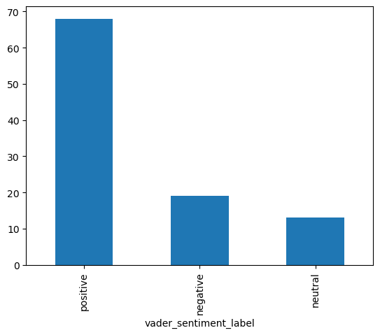
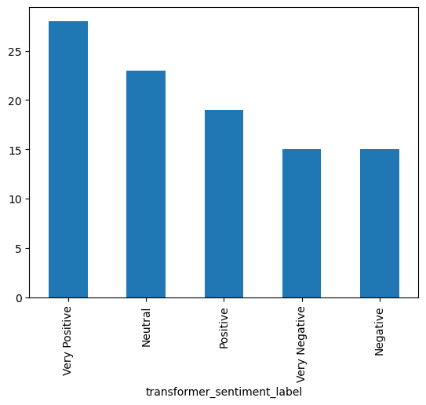

## Introduction

Sentiment analysis is a Natural Language Processing (NLP) technique that identifies and extracts the emotional tone or opinion expressed in text. It helps computers understand whether a piece of text expresses a positive, negative, or neutral opinion. It is also called Opinion Mining.

## Types of Sentiment Analysis

1. Rule-Based Sentiment Analysis: It uses predefined rules, dictionaries, and linguistic patterns to determine the sentiment of a sentence.
2. Pre-trained Transfer Learning Models:  This approach uses an already-trained NLP model and applies it to a sentiment analysis task. Instead of building and training a model from scratch, we reuse knowledge learned from a large text dataset.

## Rule-Based Sentiment Analysis

In Rule-Based Sentiment Analysis, we build a predefined sentiment dictionary. Once a sentence is provided, the system:

- Tokenizes the sentence.
- Looks up each word in the sentiment dictionary.
- Assigns sentiment scores.
- Calculates the overall score.
- Applies classification rules.

The score is calculated using:

```text
Score = Σ Sentiment(word_i), for i = 1 to n
```

Classification rules:

- Score > 0 → Positive
- Score = 0 → Neutral
- Score < 0 → Negative
Problem with Basic Rule-Based Systems
Consider the following examples:
- "You are good." → Positive
- "You are not good." → Negative
A simple dictionary-based approach identifies the word good in both sentences and may classify both as positive.

To address this limitation, we can introduce additional rules, such as:

- Reverse sentiment: Identify negation words like "not" and reverse the sentiment.
- Increase sentiment intensity: Increase the sentiment score when words like "very" or "extremely" are used.
As our sentiment dictionary and rule set grow, the system can handle more language patterns and potentially produce better results.

Popular libraries

- VADER
- TextBlob
- AFINN
### Using Textblob

TextBlob returns a score between -1 and 1, where negative scores indicate negative sentiment, and positive scores indicate positive sentiment.
```python
from textblob import TextBlob
```

```python
sentences = ["I had a great time at the movie. It was really funny.",
    "I had a great time at the movie, but the parking was terrible.",
    "I had a great time at the movie, but the parking wasn't great.",
    "I went to see a movie."]
```

```python
for i in range(0, 4):
    score = TextBlob(sentences[i]).sentiment.polarity
    print(i + 1, ":", sentences[i], ":", score)
    if score > 0:
        print("--> Positive Sentiment")
    elif score < 0:
        print("--> Negative Sentiment")
    else:
        print("--> Neutral Sentiment")
```

```text
1 : I had a great time at the movie. It was really funny. : 0.525
--> Positive Sentiment
2 : I had a great time at the movie, but the parking was terrible. : -0.09999999999999998
--> Negative Sentiment
3 : I had a great time at the movie, but the parking wasn't great. : 0.8
--> Positive Sentiment
4 : I went to see a movie. : 0.0
--> Neutral Sentiment
```

### Using VADER

VADER give a dict ```{'neg': 0.0, 'neu': 0.408, 'pos': 0.592, 'compound': 0.4404}```

### Meaning of Each Score

| Parameter | Meaning | Your Result |
|---|---|---:|
| `neg` | Proportion of negative sentiment | 0.000 |
| `neu` | Proportion of neutral sentiment | 0.408 |
| `pos` | Proportion of positive sentiment | 0.592 |
| `compound` | Overall normalized sentiment score (-1 to +1) | 0.4404 |
```python
from vaderSentiment.vaderSentiment import SentimentIntensityAnalyzer
```

```python
vader_sentiment = SentimentIntensityAnalyzer()
```

```python
for i in range(0, 4):
    score = vader_sentiment.polarity_scores(sentences[i])["compound"]
    print(i + 1, ":", sentences[i], ":", score)
    if score > 0:
        print("--> Positive Sentiment")
    elif score < 0:
        print("--> Negative Sentiment")
    else:
        print("--> Neutral Sentiment")
```

```text
1 : I had a great time at the movie. It was really funny. : 0.807
--> Positive Sentiment
2 : I had a great time at the movie, but the parking was terrible. : -0.3818
--> Negative Sentiment
3 : I had a great time at the movie, but the parking wasn't great. : -0.4387
--> Negative Sentiment
4 : I went to see a movie. : 0.0
--> Neutral Sentiment
```

## Implementing Rule-Based Sentiment Analysis
```python
import pandas as pd
import numpy as np
import re
from vaderSentiment.vaderSentiment import SentimentIntensityAnalyzer
import transformers
from transformers import pipeline
from nltk.tokenize import word_tokenize
from nltk.corpus import stopwords
from nltk.stem import WordNetLemmatizer
from sklearn.model_selection import train_test_split
from sklearn import metrics
from itertools import chain
from nltk import NaiveBayesClassifier
```

```python
data = pd.read_csv("/Users/admin/Desktop/book_reviews_sample.csv")
data.head()
```

```text
   index                                         reviewText  rating
0  11494  Clean and funny. A bit busy with all the diffe...       3
1    984  Alex a sexy hot cop and the PhD candidate. Wha...       4
2   1463  Good thing that this is a free story. I read i...       1
3  10342  Action, action, action! Equipment keeps gettin...       4
4   5256  this was hands down the worse book i have ever...       1
```

```python
data.info()
```

```text
<class 'pandas.core.frame.DataFrame'>
RangeIndex: 100 entries, 0 to 99
Data columns (total 3 columns):
 #   Column      Non-Null Count  Dtype 
---  ------      --------------  ----- 
 0   index       100 non-null    int64 
 1   reviewText  100 non-null    object
 2   rating      100 non-null    int64 
dtypes: int64(2), object(1)
memory usage: 2.5+ KB
```

```python
data['reviewText'][0]
```

```text
'Clean and funny. A bit busy with all the different plots going on. But overall a good read. Bye now.'
```

```python
data['reviewText_clean'] = data['reviewText'].str.lower()
```

```python
data['reviewText_clean'] = data.apply(lambda x: re.sub(r"([^\w\s])", "", x['reviewText_clean']), axis=1)
```

```python
data.head()
```

```text
   index                                         reviewText  rating  \
0  11494  Clean and funny. A bit busy with all the diffe...       3   
1    984  Alex a sexy hot cop and the PhD candidate. Wha...       4   
2   1463  Good thing that this is a free story. I read i...       1   
3  10342  Action, action, action! Equipment keeps gettin...       4   
4   5256  this was hands down the worse book i have ever...       1   

                                    reviewText_clean  
0  clean and funny a bit busy with all the differ...  
1  alex a sexy hot cop and the phd candidate what...  
2  good thing that this is a free story i read it...  
3  action action action equipment keeps getting b...  
4  this was hands down the worse book i have ever...  
```

##  Implementing Rule-Based Sentiment Analysis With VADER
```python
vader_sentiment = SentimentIntensityAnalyzer()
```

```python
print(vader_sentiment.polarity_scores('You are good.'))
data['vader_sentiment_score'] = data['reviewText_clean'].apply(lambda review: vader_sentiment.polarity_scores(review)['compound'])
```

```text
{'neg': 0.0, 'neu': 0.408, 'pos': 0.592, 'compound': 0.4404}
```

### Meaning of Each Score

| Parameter | Meaning | Your Result |
|---|---|---:|
| `neg` | Proportion of negative sentiment | 0.000 |
| `neu` | Proportion of neutral sentiment | 0.408 |
| `pos` | Proportion of positive sentiment | 0.592 |
| `compound` | Overall normalized sentiment score (-1 to +1) | 0.4404 |
```python
bins = [-1, -0.1, 0.1, 1]
names = ['negative', 'neutral', 'positive']

data['vader_sentiment_label'] = pd.cut(data['vader_sentiment_score'], bins, labels=names)
```

```python
data['vader_sentiment_label'].value_counts().plot.bar()
```

```text
<Axes: xlabel='vader_sentiment_label'>
```



## Pre-trained Transformer Model For Sentiment Analysis

pre-trained transformer model is a deep learning model that has already been trained on a large amount of text data to understand language, grammar, context, and relationships between words. Instead of building and training a model from scratch, we reuse an existing model for sentiment analysis. 

```python
import transformers
from transformers import pipeline
```

```python
sentiment_pipeline = pipeline("sentiment-analysis")
```

```text
No model was supplied, defaulted to distilbert/distilbert-base-uncased-finetuned-sst-2-english and revision 714eb0f (https://huggingface.co/distilbert/distilbert-base-uncased-finetuned-sst-2-english).
Using a pipeline without specifying a model name and revision in production is not recommended.

config.json:   0%|          | 0.00/629 [00:00<?, ?B/s]
model.safetensors:   0%|          | 0.00/268M [00:00<?, ?B/s]
tokenizer_config.json:   0%|          | 0.00/48.0 [00:00<?, ?B/s]
vocab.txt: 0.00B [00:00, ?B/s]
Device set to use mps:0
```

```python
print(sentences[0], ' : ', sentiment_pipeline(sentences[0]))
for i in range(0, 4):
    print(sentences[i], ":", sentiment_pipeline(sentences[i])[0]['label'])
    
```

```text
I had a great time at the movie. It was really funny.  :  [{'label': 'POSITIVE', 'score': 0.9998732805252075}]
I had a great time at the movie. It was really funny. : POSITIVE
I had a great time at the movie, but the parking was terrible. : NEGATIVE
I had a great time at the movie, but the parking wasn't great. : NEGATIVE
I went to see a movie. : POSITIVE
```

## Implementing Sentiment Analysis Using BERT Model 

```python
transformer_pipeline = pipeline(
    "sentiment-analysis",
    model="nlptown/bert-base-multilingual-uncased-sentiment"
)
```

```text
config.json:   0%|          | 0.00/953 [00:00<?, ?B/s]
model.safetensors:   0%|          | 0.00/669M [00:00<?, ?B/s]
tokenizer_config.json:   0%|          | 0.00/39.0 [00:00<?, ?B/s]
vocab.txt: 0.00B [00:00, ?B/s]
special_tokens_map.json:   0%|          | 0.00/112 [00:00<?, ?B/s]
Device set to use mps:0
```

```python
sentiment_labels = {
    1: "Very Negative",
    2: "Negative",
    3: "Neutral",
    4: "Positive",
    5: "Very Positive"
}

# This model predicts five sentiment levels, ranging from very negative (1 star) to very positive (5 stars).
```

```python
transformer_labels = []

for review in data['reviewText_clean'].values:
    sentiment_list = transformer_pipeline(review)
    sentiment_label = sentiment_list[0]['label']
    stars = int(sentiment_label.split()[0])
    sentiment_text = sentiment_labels[stars]
    transformer_labels.append(sentiment_text)
data['transformer_sentiment_label'] = transformer_labels
```

```python
data['transformer_sentiment_label'].value_counts().plot.bar()
```

```text
<Axes: xlabel='transformer_sentiment_label'>
```



