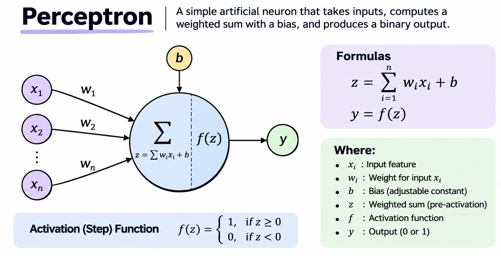

# My little Neural Network

What is Neural Networks ?

Neural Networks are machine learning models inspired by the human brain. They consist of interconnected layers of artificial neurons (perceptrons). These neurons work together to form a network, and multiple layers of neurons create a Multilayer Neural Network.

so, what is perceptrons ?

Perceptron is individual computational unit of artificial neural network, which takes decisions by combining inputs with weights and applying an activation function.



**Perceptron Formula**

```text
    x  = (w1 * x1) + (w2 * x2) + ... + (wn * xn) + b
```

Where:
    - z = Weighted sum (pre-activation output)
    - x = Input features
    - w = Weight assigned to each input
    - b = Bias (adjustable constant)
    - n = Number of input features

**Activation Function**

```text
    y = f(z)
```

Where:
    - y = Neuron output
    - f = Activation function (ReLU, Sigmoid, Tanh, etc.)
    - z = Weighted sum of inputs and bias

Back in the day, we started with basic Neural Networks. Today, we have advanced architectures like RNNs, LSTMs, and Transformers. But where do Neural Networks fit into this evolution?

```text
Artificial Intelligence (AI)
        |
        +-- Machine Learning
        |       |
        |       +-- Traditional ML
        |       |     +-- Decision Trees
        |       |     +-- SVM
        |       |     +-- Random Forest
        |       |
        |       +-- Neural Networks
        |              |
        |              +-- Perceptron
        |              +-- ANN / MLP
        |              +-- CNN
        |              +-- RNN
        |              |    +-- LSTM
        |              |    +-- GRU
        |              |
        |              +-- Autoencoders / VAE
        |              +-- GAN
        |              +-- GNN
        |              +-- Transformers
        |                    +-- BERT
        |                    +-- GPT
        |                    +-- Vision Transformers
        |                    +-- Multimodal LLMs
        |
        +-- Generative AI
               +-- GANs
               +-- VAEs
               +-- Autoregressive models
               +-- Diffusion models
            +-- Foundation models

Prompted by me, generated by GPT.
```

## It would be so cool to implement a Perceptron. Let's do it!

Below are implementations of the AND, OR, and NOT gates using a single perceptron (or, as the big people call it, a single-layer perceptron classifier).

**Why these gates? Because I know...**

- **AND Gate**
    

- **OR Gate**
- **NOT Gate**